# Dashboard UI evidence

These contact sheets show the dashboard before and after the UI polish. Each sheet contains the Ready, Connecting, Live, Reconnecting, Unavailable, and Diagnostics states in that order.

The before captures use `origin/main` at `824e2b1`. The after captures use the implementation in this branch. Both sets were rendered in Chromium against the same deterministic mock camera feed at 360, 768, 1024, and 1280 px viewport widths, in light and dark themes. The Live tile uses the mock JPEG stream.

| Viewport | Before | After |
| --- | --- | --- |
| 360 px, light | 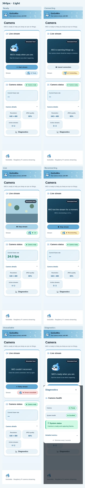 | 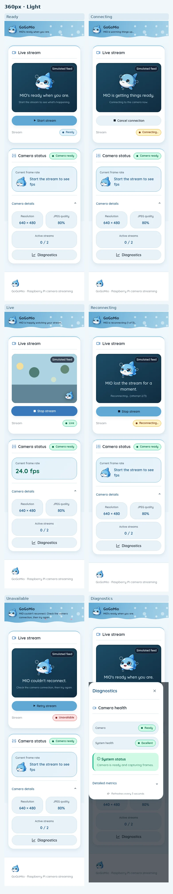 |
| 360 px, dark | 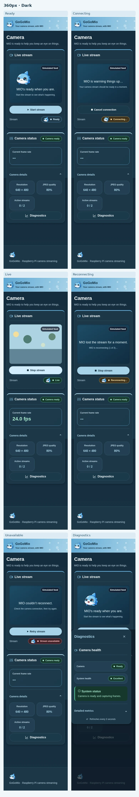 | 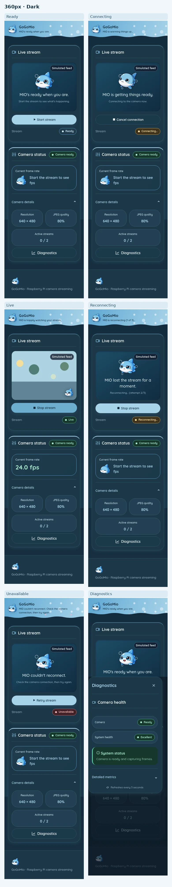 |
| 768 px, light | 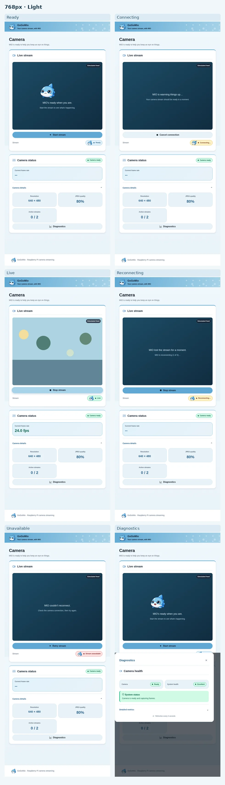 | 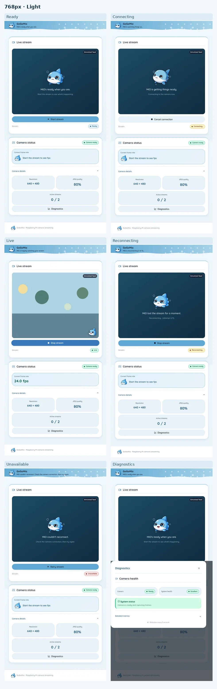 |
| 768 px, dark | 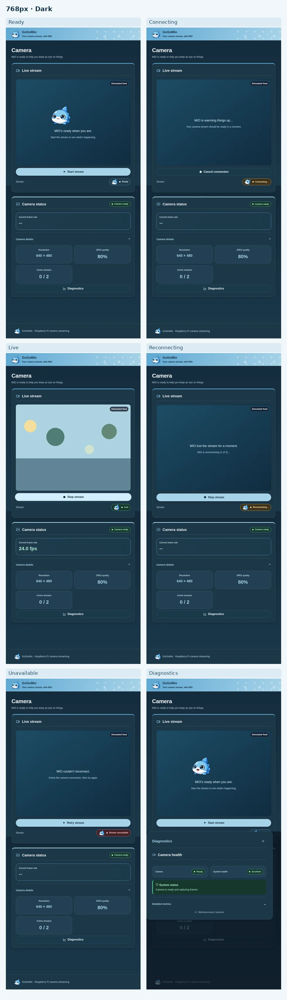 | 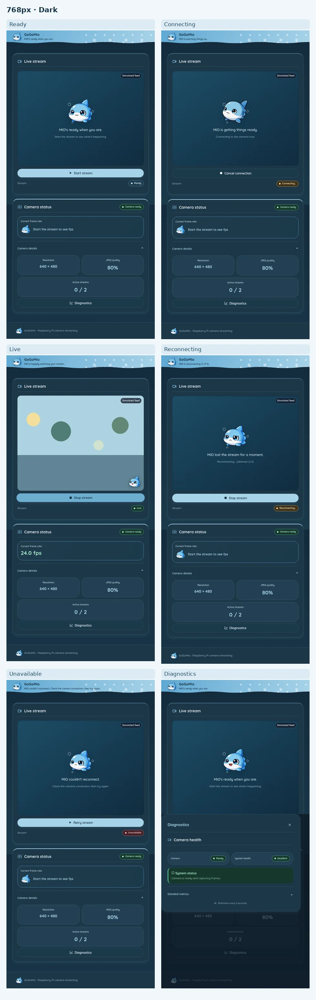 |
| 1024 px, light | 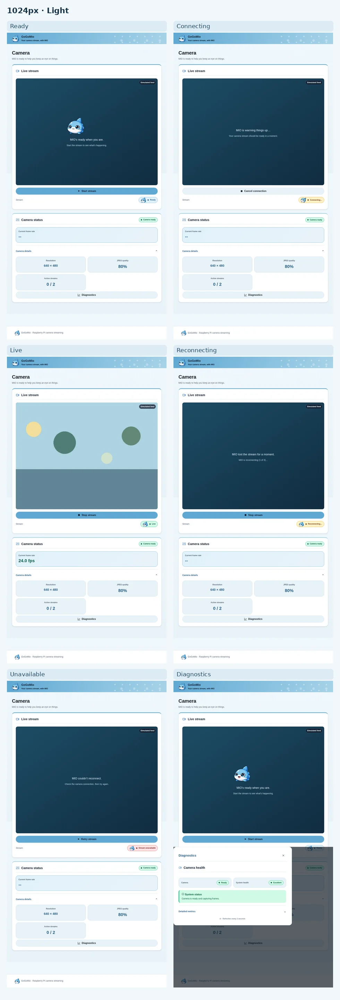 | 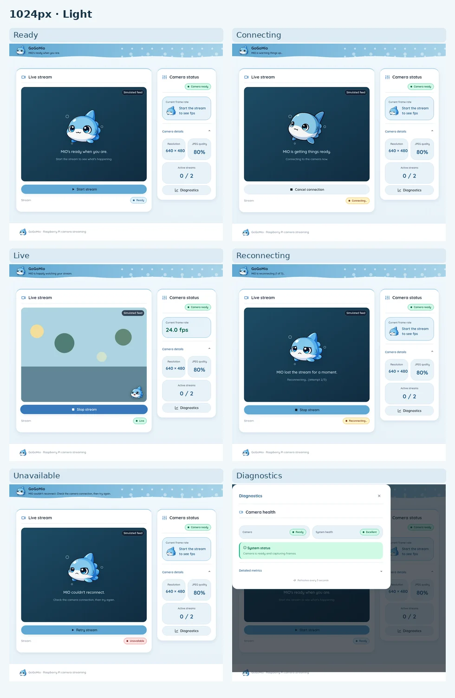 |
| 1024 px, dark | 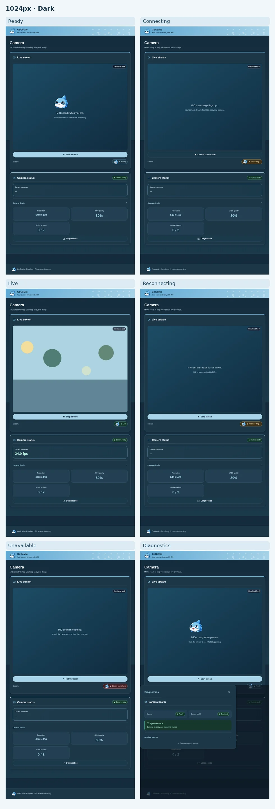 | 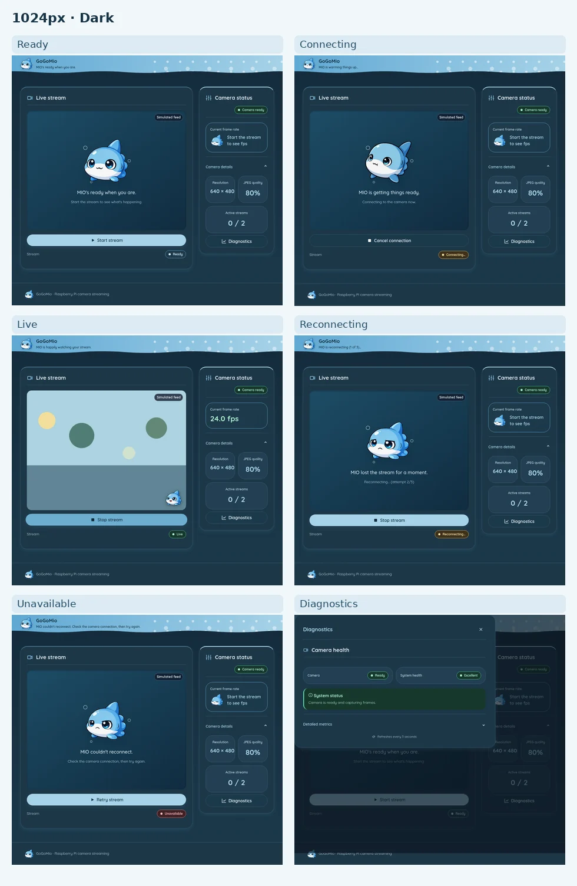 |
| 1280 px, light | 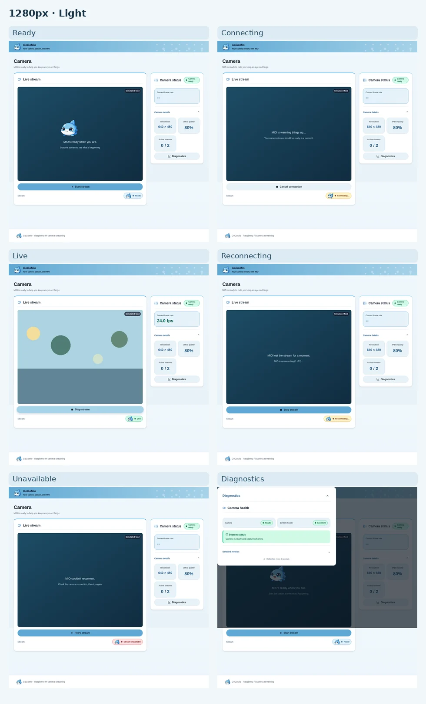 | 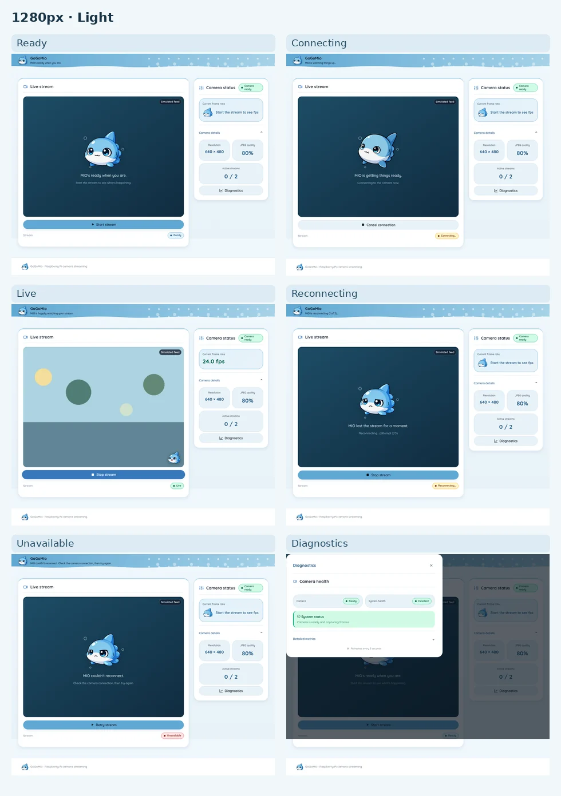 |
| 1280 px, dark | 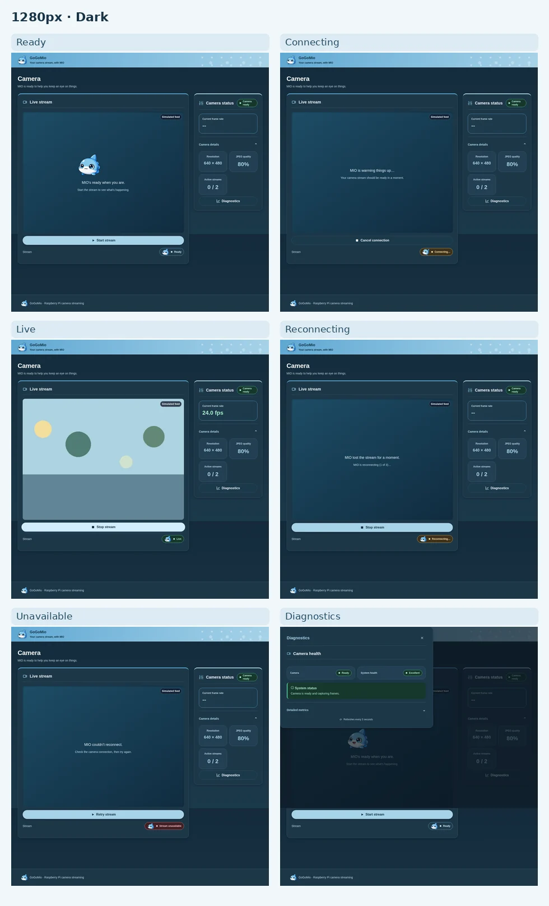 | 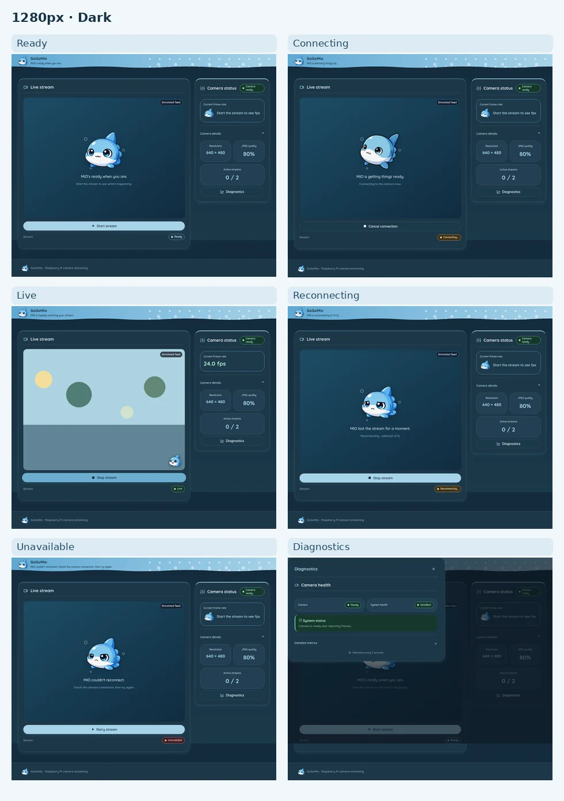 |

Additional after captures show the new capacity and idle-sleep states:

- [At capacity, 1024 px light](after/1024-light-capacity.webp)
- [Idle sleep, 1024 px light](after/1024-light-sleeping.webp)
